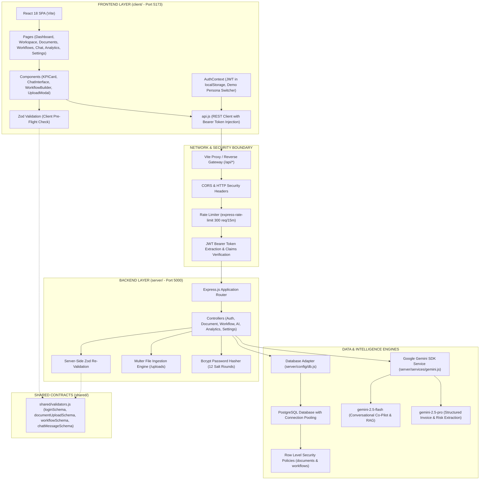

# 🏛️ CorpMind AI — System Architecture & Layer Differentiation

This document details the boundary, separation of concerns, and data flow between the **Frontend (Client)** and **Backend (Server)** subsystems.

---

## 🗺️ Architectural Separation Diagram

---

## ⚖️ Side-by-Side Comparison: Frontend vs Backend

| Dimension | Frontend (`client/`) | Backend (`server/`) |
| :--- | :--- | :--- |
| **Primary Role** | Presentation, interactive UI, state management, charts, and user experience. | Business logic, document parsing, AI orchestration, database queries, and security. |
| **Runtime Environment** | Web Browser Sandbox (V8 / Chromium / WebKit) | Node.js v20+ Server Runtime |
| **Host & Port** | `http://localhost:5173` | `http://localhost:5000` |
| **Core Frameworks** | React 18, React Router v6, Tailwind CSS, Recharts, Lucide React | Express.js, `pg` (PostgreSQL), `@google/genai`, `jsonwebtoken`, `bcryptjs` |
| **Secrets & Keys** | **None.** No API keys, no database credentials, no JWT secrets. | Contains `GEMINI_API_KEY`, `DATABASE_URL`, `JWT_SECRET`, and password hashes. |
| **Data Storage** | Temporary `localStorage` (JWT token & non-sensitive session profile). | Persistent PostgreSQL database with automated audit logs and RLS data isolation. |
| **File Handling** | Drag-and-drop file picker, client OCR text preview, FormData construction. | Multer multipart streaming, disk storage in `/uploads`, binary text extraction. |
| **AI Invocation** | Never calls AI models directly; dispatches requests to `/api/ai/*`. | Invokes Google Gen AI SDK (`gemini-2.5-flash` and `gemini-2.5-pro`) server-side. |
| **Validation** | Client-side pre-flight validation via Zod for immediate user feedback. | Authoritative re-validation via Zod schemas to reject malformed or malicious payloads. |
| **Authentication** | Stores token, attaches `Authorization: Bearer <token>` to requests. | Validates token signatures, enforces expiration, and extracts user role and department. |
| **Data Isolation** | Renders views conditioned on user role and department claims. | Database-level Row-Level Security (`current_setting('request.jwt.claim.department')`). |

---

## 🔒 Security & Boundary Isolation Principles

1. **Defense in Depth**:
   - Validation occurs first on the client for responsive UX, and is strictly re-executed on the server before database mutation.
2. **Database Row-Level Security (RLS)**:
   - The frontend cannot bypass data isolation because the backend database sets session claims (`request.jwt.claim.role` and `request.jwt.claim.department`) on the active PostgreSQL transaction. Queries return only rows matching the user's authorized departmental realm.
3. **API Key Isolation**:
   - The user's Google Gemini API key is never bundled in the frontend or transmitted to the browser client. All generative AI requests are signed and executed exclusively on the backend server.
